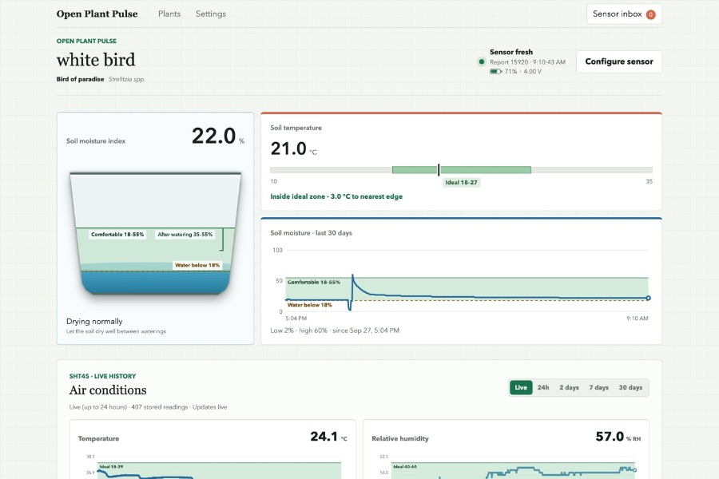

# Open Plant Pulse

### Your plants have been telling you what they need all along.

Nobody was listening, because nobody could hear it.

---

## Four things

Ask anyone who grows plants for a living and they will tell you the same four
things matter. **Light. Water. Air. Food.**

Everybody knows this. The trouble is that knowing it has never helped, because
you cannot see any of them. You cannot see light the way a leaf sees it. You
cannot see how much water is left in a pot. You cannot see the pull the air is
making on a leaf. You cannot see what is left in the soil after six weeks.

So we guess. We water on Sundays. We move a plant toward the window and hope.
We buy a moisture meter that reads *moist* in dry soil and *dry* in wet soil.

Open Plant Pulse makes all four visible. Two of them it takes care of for you.

---

### Light — measured, then run

Not "bright, indirect." A number: how much light that plant actually received
today, in mol/m²/day, the unit growers use. Against what its species wants.

When it is short, the hub says what too little looks like **on that kind of
leaf** — a dracaena running bare between leaves is not a begonia bleaching at
the edge. When it is too much, the same.

And it runs the lamps. Give a light to a plant and it keeps that plant's hours.
The hub asks the lamp afterwards whether it really came on, and tells you when
it did not.

### Water — weighed, not guessed

This is the one everybody gets wrong, and the one with the simplest answer.

**Water is heavy.** A pot that weighed 1,912 g on Monday and 1,760 g today has
given up 152 ml, and a plant doing that every day will be thirsty on a date
you can work out in advance.

So the hub weighs. It learns each plant's own rate — not a species average, not
a reminder every seven days — and tells you which pot needs water today and
which one you can leave for five more days. It knows that a plant drinks harder
in dry air and divides that out before concluding anything.

You need no hardware for this. A kitchen scale and ten seconds is enough.

### Air — watched, and held

Temperature and humidity, and the number that actually matters: **vapour
pressure deficit**, the pull the air makes on a leaf. Two rooms at 22 °C can be
completely different places to be a plant.

And where there is a fan, the hub holds the humidity where you asked — a proper
control loop, not a thermostat that slams on and off.

### Food — logged, and read in the soil

Every feed, recorded against the plant that got it. And for pots with a probe:
conductivity, pH, and nitrogen, phosphorus and potassium against the range that
species wants. So "when did I last feed it" and "does it still need feeding"
stop being the same question with no answer.

---

## And it is yours

No account. No cloud. No subscription. No app store. No company that can
discontinue it.

It runs on a Mac or a Linux box in your home, on a database you can open with
any SQLite browser, and it talks to the Zigbee radio itself — no Home
Assistant, no bridge, no broker, no second hub from whoever made the sensor.

Nothing about your house leaves your house.

---

<table>
<tr>
<td width="33%" valign="top">
<a href="docs/images/hub-plant-page.jpg"></a>
<br><b>Every plant gets a page</b>
<br><sub>Water left in the pot and when it runs out, light against what the
species wants, the air it has been living in, and a year of what you did.</sub>
</td>
<td width="33%" valign="top">
<a href="docs/images/hub-lights.jpg"></a>
<br><b>Lights that answer back</b>
<br><sub>Each lamp keeps its plant's hours, and the hub checks the lamp really
switched rather than assuming the command worked.</sub>
</td>
<td width="33%" valign="top">
<a href="docs/images/hub-sensor-configuration.jpg"></a>
<br><b>Everything ever measured</b>
<br><sub>Any reading a device has sent, drawn over time — down to the watts a
grow light is pulling out of the wall.</sub>
</td>
</tr>
</table>

---

## Start with nothing

```sh
git clone https://github.com/keefo/open-plant-pulse.git
cd open-plant-pulse
PYTHONPATH=hub/src python3 -m open_plant_pulse_hub
```

Open <http://localhost/>. Add a plant. Put its pot on a kitchen scale and type
the number in. Do it again tomorrow.

That is the whole setup. Python 3.9 and three dependencies — there is no step
four.

## Add sensors when you want them

Ordinary Zigbee devices, from any shop. Plug a Zigbee stick into the computer
and pair them to it directly.

| What | What it gives you |
| --- | --- |
| Soil probes | Moisture, soil temperature, EC, pH, and NPK |
| Thermometers | Room air and humidity — most of why a plant drinks faster some weeks |
| Smart plugs | Grow lights on a schedule, and what each one costs in watts |
| Leak sensors | A puddle under a pot, before it reaches the floor |
| A scale | Weight without lifting — ours is in `sensors/hx711-scale` |

Twelve species profiles ship with it: pothos, monstera, alocasia, begonia,
dracaena, orchid, spider plant, strelitzia, jasmine, anthurium, tillandsia,
and a general one for anything leafy.

---

## Going deeper

- [The hub guide](docs/hub.md) — running it as a background service
- [Architecture](docs/architecture.md) — how the pieces fit together
- [Firmware](docs/firmware.md) — building and flashing our own hardware
- [Roadmap](docs/roadmap.md) and [design proposals](docs/proposals/)

> [!NOTE]
> These guides are older than the rest of the project. They were written when
> sensors broadcast over Bluetooth, and most still describe it that way. The
> hub speaks Zigbee now; where a guide and the code disagree, the code is
> right.

```text
open-plant-pulse/
├── hub/         The thing you run. Python, three dependencies, SQLite.
├── sensors/     Hardware of our own: the weighing scale, an older soil probe
├── docs/        Guides, architecture, and design proposals
├── deploy/      Running it as a background service
└── scripts/     Repository checks
```

Tests: `python3 hub/tests/run.py`, or `sh scripts/check.sh` for the whole
repository.

## Honest status

This is one household's system, run every day on twenty plants. It is good at
the things that house needed and rough at the rest.

| Solid | Rough |
| --- | --- |
| Weighing, watering forecasts, care history | Packaging — you run it from a checkout |
| Zigbee soil probes, thermometers, plugs, leak sensors | Only the devices above are known to work |
| Light schedules, with the switch confirmed | Humidity control needs a Moonraker-driven fan |
| Power metering, VPD, species profiles | No public API yet, and no mobile app |

MIT licensed. Take it and make it yours.
