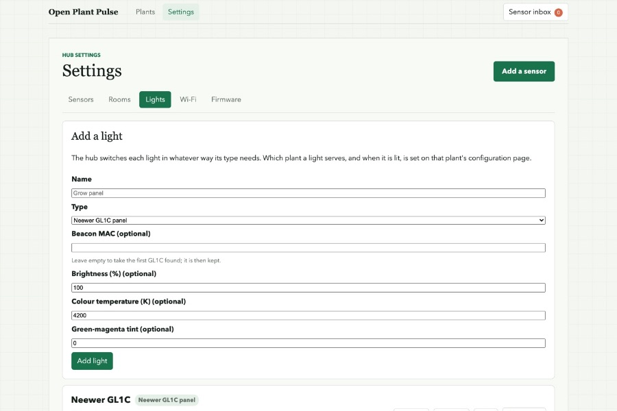
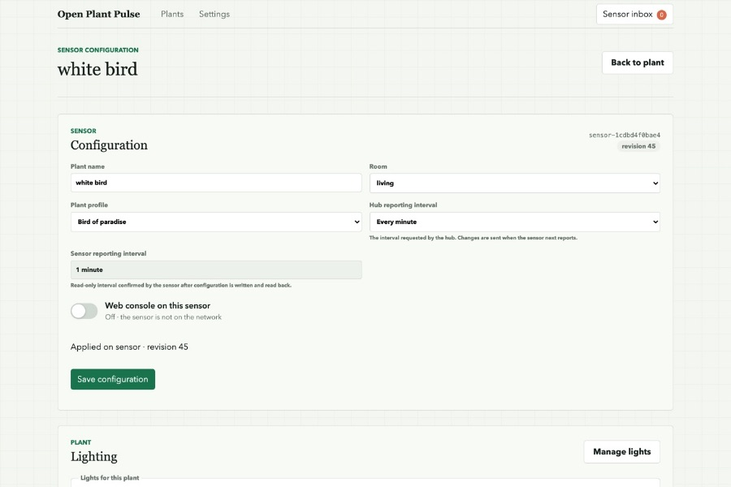

# Open Plant Pulse

**Know when to water, without guessing and without the cloud.**

Open Plant Pulse runs on a Mac or a Linux box in your home. You tell it about
your plants; it learns how fast each one drinks and tells you which pot needs
water today — and which one you can leave alone for another five days.

Nothing leaves the house. There is no account, no app store, no subscription,
and no company that can switch it off.

## The idea: a pot is a water tank

A plant in a pot is the easiest thing in the house to measure, because **water
is heavy**. A pot that weighed 1,912 g after watering and weighs 1,760 g today
has given up 152 ml, and a plant that does that every day will be thirsty on a
day you can work out in advance.

That is the whole trick. No probe can tell you what a kitchen scale can.

<table>
<tr>
<td width="33%" valign="top">
<a href="docs/images/hub-plant-page.jpg"></a>
<br><b>Each plant gets a page</b>
<br><sub>How much water is left in the pot, when it will run out, what the air
around it has been doing, and everything you have ever done to it.</sub>
</td>
<td width="33%" valign="top">
<a href="docs/images/hub-lights.jpg"></a>
<br><b>Grow lights on a timer</b>
<br><sub>Give a lamp to a plant and it keeps that plant's hours. The hub checks
the light really came on, and says so when it did not.</sub>
</td>
<td width="33%" valign="top">
<a href="docs/images/hub-sensor-configuration.jpg"></a>
<br><b>Devices, if you add any</b>
<br><sub>Everything a sensor has ever measured, drawn over time — including
what your plugs are drawing in watts.</sub>
</td>
</tr>
</table>

## You do not need to buy anything

The simplest way to use this is a **kitchen scale you already own**.

1. Put the pot on the scale after you water it. Type the number in.
2. Do it again when you next walk past. Any day will do.
3. After two or three weighings the hub knows the plant's rate and starts
   telling you when it will be thirsty.

That is it. Most of the plants in the house this was built for are looked after
exactly that way — weighed by hand, about once a day, no electronics in the pot
at all.

## If you want it to do the weighing itself

The hub talks to ordinary **Zigbee** devices — the kind sold in any shop. It
runs the radio itself, so you do not need Home Assistant, a bridge, a broker,
or a hub from whoever made the sensor. Plug a Zigbee USB stick into the
computer and pair devices to it directly.

Known to work, because they are the ones in daily use here:

| What | Gives you |
| --- | --- |
| Zigbee soil probes | Moisture and soil temperature, without touching the pot |
| Zigbee thermometers | Room air, which is most of why a plant drinks faster some weeks |
| Zigbee smart plugs | Grow lights on a schedule, plus what each one costs in watts |
| Zigbee leak sensors | A puddle under a pot, before it reaches the floor |

There is also a **weighing scale of our own** in `sensors/hx711-scale` — an
ESP32 and a load cell that sits under one pot and reports its weight over
Zigbee, so that plant never needs lifting. Build it if you like; nothing else
depends on it.

## What it works out for you

- **When to water.** Measured from the pot's own weight, against the rate this
  particular plant has been drinking at — not a fixed number of days.
- **How confident it is.** "In 3 days" and "somewhere between 2 and 8 days" are
  different sentences, and you get the honest one.
- **Whether the room explains it.** A plant drinking twice as much in dry air
  has not changed; the air has. The hub divides that out before it concludes
  anything about the plant.
- **When you disagree.** If you look at a pot the hub called thirsty and it is
  plainly still wet, say so. It takes that as evidence and adjusts.
- **Light.** Daily light against what the species actually wants, and what too
  little or too much looks like on that kind of leaf.

Twelve plant profiles ship with it — pothos, monstera, alocasia, begonia,
dracaena, orchid, spider plant, strelitzia, jasmine, anthurium, tillandsia, and
a general one for anything leafy.

## Try it

You need Python 3.9 or newer. Nothing else.

```sh
git clone https://github.com/keefo/open-plant-pulse.git
cd open-plant-pulse
PYTHONPATH=hub/src python3 -m open_plant_pulse_hub
```

Then open <http://localhost/>, add a plant, and weigh it.

## Going deeper

- [The hub guide](docs/hub.md) — running it as a background service
- [Architecture](docs/architecture.md) — how the pieces fit together
- [Firmware](docs/firmware.md) — building and flashing our own hardware
- [Roadmap](docs/roadmap.md) and [design proposals](docs/proposals/)

> [!NOTE]
> These guides are older than the rest of the project. They were written when
> sensors broadcast over Bluetooth, and most of them still describe it that
> way. The hub speaks Zigbee now; where a guide and the code disagree, the
> code is right. Rewriting them is on the list.

## Where things are

```text
open-plant-pulse/
├── hub/         The thing you run. Python, three dependencies, SQLite.
│   ├── src/     The hub itself
│   └── tests/   Its tests
├── sensors/     Hardware of our own: the weighing scale, and an older soil probe
├── docs/        Guides, architecture, and design proposals
├── deploy/      Running it as a background service
└── scripts/     Repository checks
```

Run the checks with `sh scripts/check.sh`, or the hub's own suite with
`python3 hub/tests/run.py`.

## Honest status

This is one household's system, used every day, and it is rough in places.

| Works well | Still rough |
| --- | --- |
| Manual weighing, watering forecasts, care history | Packaging — you run it from a checkout |
| Zigbee soil probes, thermometers, plugs, leak sensors | Only the devices listed above are known to work |
| Grow light schedules, with the switch confirmed | Our own soil-probe hardware is older than the rest |
| Power metering on plugs that support it | No public API yet, and no mobile app |

The project is licensed under the [MIT License](LICENSE).
