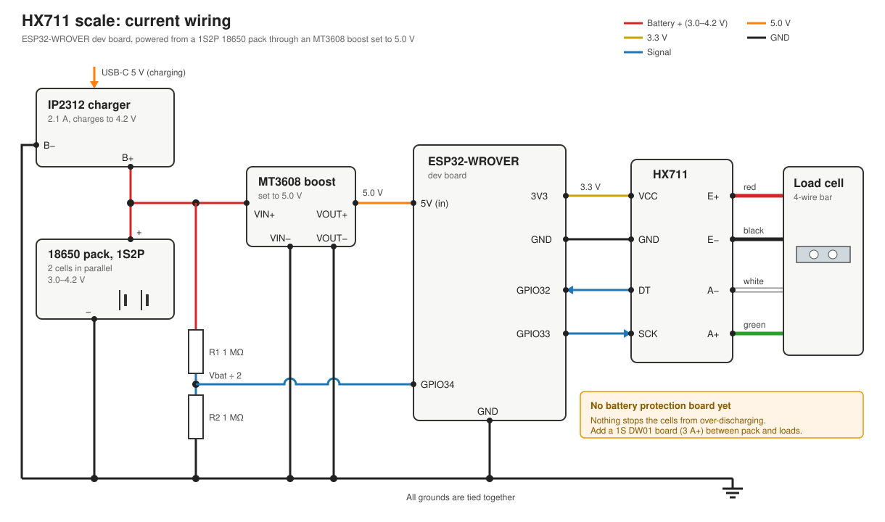

# HX711 scale

A battery-powered scale: a 4-wire load cell read by an HX711, on an ESP32-WROVER dev board running ESP-IDF. It powers from a 1S2P 18650 pack and charges over USB-C.



## Parts

| Part | Notes |
|---|---|
| ESP32-WROVER dev board | Prototype board. Plan to move to a Seeed XIAO ESP32-C6 for the low-power build |
| HX711 module | 24-bit ADC and amplifier for the load cell |
| Load cell | 4-wire bar type |
| 2 × 18650 cells | Wired 1S2P (in parallel): 3.0–4.2 V |
| IP2312 module | USB-C charger for the pack, 2.1 A |
| MT3608 module | Boost converter, **set to 5.0 V** |
| 2 × 1 MΩ resistors | Battery voltage divider (optional) |

## Wiring

### Power

| From | To |
|---|---|
| 18650 pack + | IP2312 B+, MT3608 VIN+ |
| 18650 pack − | IP2312 B−, GND |
| MT3608 VOUT+ | ESP32 **5V** pin |
| MT3608 VIN−, VOUT− | GND |

The 3V3 pin gets no input. The dev board's own regulator makes 3.3 V from the 5V pin, and 3V3 is used as an output to power the HX711.

### ESP32 ↔ HX711

The scale now runs on an ESP32-C6-DevKitC-1 (ESP32-C6-WROOM-1). Pins for the original WROVER are in brackets.

| ESP32-C6 (WROVER) | HX711 |
|---|---|
| 3V3 | VCC |
| GND | GND |
| GPIO 1 (32) | DT (DOUT) |
| GPIO 2 (33) | SCK |

On the C6 board, plug the Mac into the port marked **USB**, not **UART**. Build with `idf.py set-target esp32c6` (or `esp32` for the WROVER).

### HX711 ↔ load cell

| Load cell wire | HX711 |
|---|---|
| Red | E+ |
| Black | E− |
| White | A− |
| Green | A+ |

Wire colours vary between makers. If the weight reads negative when you press on the cell, swap A+ and A−.

### Battery monitor (optional)

Battery + → 1 MΩ → **GPIO 0** (GPIO 34 on the WROVER) → 1 MΩ → GND. The firmware doubles the reading to get the battery voltage. Both pins are on ADC1, which still works while Wi-Fi is on.

### Pins to avoid on the ESP32-C6

- **GPIO 4, 5, 8, 9, 15:** strapping pins (8 also drives the RGB LED, 9 is the BOOT button)
- **GPIO 12, 13:** the USB port
- **GPIO 16, 17:** the UART port

### Pins to avoid on the WROVER

- **GPIO 16, 17:** used by the PSRAM
- **GPIO 6–11:** used by the flash chip
- **GPIO 0, 2, 5, 12, 15:** strapping pins, which can stop the board from booting or flashing
- **GPIO 34–39:** input only

## Build and flash

Needs ESP-IDF v5.5 (installed at `~/esp/esp-idf`).

```sh
cd ~/Documents/projects/hx711_scale
. ~/esp/esp-idf/export.sh
idf.py set-target esp32          # first time only
idf.py -p /dev/cu.usbserial-XXXX flash monitor
```

Find the port with `ls /dev/cu.*`. Press `Ctrl+]` to leave the monitor.

## Using it

### Remote control

The firmware can talk to other devices in one of three ways, picked with `CONFIG_SCALE_LINK_*` in `sdkconfig.defaults` (delete `sdkconfig` after changing it):

| Link | How to use it |
|---|---|
| **Wi-Fi** (default) | Join **HX711-Scale** (password `scale1234`) and open **http://192.168.4.1**, or set `SCALE_HOME_WIFI_SSID` and `SCALE_HOME_WIFI_PASS` under `idf.py menuconfig` → HX711 scale, which writes them to the git-ignored `sdkconfig`, and open **http://scale.local**. They are only read by a board that has never joined a network: whatever the Wi-Fi driver last saved wins over them. The page can also update the firmware over the air. |
| **Bluetooth** | Open `mac/scale.html` in Chrome and press **Bluetooth**. |
| **USB only** (no radio) | Open `mac/scale.html` in Chrome and press **USB**. |

Every link shows the live weight, a 2-minute chart, the noise level and the battery voltage, with Tare/Calibrate buttons and the debug messages. The **BOOT** button on the board also tares.

**Current state:** this board's 3.3 V regulator is damaged (3V3 sits at 3.0 V and dips under load), so it resets whenever Wi-Fi or Bluetooth starts. It runs the USB-only link until the regulator or board is replaced.

### Weight API

`GET http://scale.local/api/weight` (or the scale's IP address) returns the current weight. Each scale's address comes from its name, see below.

```json
{"name":"Scale","grams":245.0,"unit":"g","stable":true,"status":"ok","step":5,"seq":1234}
```

| Field | Meaning |
|---|---|
| `grams` | Weight rounded to the display step, or `null` when `status` isn't `ok`. Small dips below zero read 0. |
| `stable` | `true` once the reading has stayed within one step for a second. Wait for this before using the value. |
| `status` | `ok`, `starting`, `not_calibrated`, `sensor_error` (HX711 not answering) or `overload` (reading maxed out) |
| `step` | Display step in grams |
| `seq` | Reading number; it goes up with each new reading, so the same value twice means no new reading |
| `interval_s` | Seconds between readings, 0 = continuous (10 per second) |
| `age_s` | Seconds since this reading was taken |
| `battery` | `{volts, percent, low}`; percent is estimated from voltage, `low` is under 20%. `null` if the divider isn't wired |
| `fw` | Firmware version (`PROJECT_VER` in `CMakeLists.txt`; raise it with each release) |
| `build` | Build ID, the first 8 hex digits of the firmware's SHA-256; changes with every build |

### Power saving

- The scale's own network (HX711-Scale) only runs when the home Wi-Fi isn't available. With it off, the Wi-Fi radio and processor sleep between router beacons.
- **Sampling** (on the page, or command `i <seconds>`) sets how often the scale weighs: 10 per second, or once every 1 s to 12 h (43200 s). Between interval readings the HX711 is powered down. The setting is saved.
- Zero is saved with each tare and kept across restarts, so a plant left on the scale keeps its weight through a reboot or update.

The reply also has the scale's `name`. Set the name in the **Name** section of the page (or `POST /api/name` with the name as the body). It also sets the address: "Kitchen Scale" answers at http://kitchen-scale.local.

Any web page can read it (it sends `Access-Control-Allow-Origin: *`). `/api/status` has everything the scale page uses, including the log.

### Serial monitor

At boot the firmware zeroes (tares) the scale, then prints a line about every half second:

```
raw   -123456   delta    45678   weight    1000.2 g   batt 3.98 V
```

Type a command in the serial monitor and press Enter (the page buttons do the same):

| Command | What it does |
|---|---|
| `t` | Tare: zero the scale. Do this with nothing on it |
| `1000` (any number) | Calibrate: put a known weight on first, then type its weight in grams |
| `r` | Clear the saved calibration |

The calibration factor is saved to flash (NVS), so you only need to do it once.

### Troubleshooting messages

| Message | Likely cause |
|---|---|
| `HX711 not responding` | VCC, GND, DT or SCK wire loose or on the wrong pin |
| `Reading is maxed out` | A load cell wire is loose, or E+/E−/A+/A− are mixed up |
| `Reading barely changed` during calibration | No weight on the cell, or the cell can't bend: fix one end and load the other |
| Weight drifts or jumps | Shared GND missing, or the load cell isn't firmly mounted |

## Files

| File | Contents |
|---|---|
| `main/hx711.c`, `main/hx711.h` | HX711 bit-bang driver |
| `main/main.c` | Tare, calibration, serial commands, battery reading |
| `main/remote.c`, `main/remote.h` | Shared state for the links: latest reading, messages, commands |
| `main/web.c`, `main/index.html` | Wi-Fi link: web server, web page, over-the-air updates |
| `main/ble.c` | Bluetooth link |
| `main/usb.c` | USB-only link |
| `mac/scale.html` | Chrome page for the Bluetooth and USB links |
| `main/wifi_config.h` | Home Wi-Fi name and password |
| `wiring.svg` | Wiring diagram |

## To do

- **Add a 1S protection board** (DW01 + 8205A, 3 A or more) between the pack and everything else. Right now nothing stops the cells over-discharging.
- **Low-battery cutoff in firmware:** deep sleep with no wake-up when the battery drops below about 3.3 V.
- **Wireless:** send readings over Wi-Fi/MQTT or ESP-NOW.
- **Low power:** wake, read, send, then deep sleep, and power down the HX711 between readings.
- **Move to the XIAO ESP32-C6** for the final build (about 15 µA in deep sleep, built-in charger). The MT3608 isn't needed there, because the pack goes straight to the XIAO's BAT pads.
